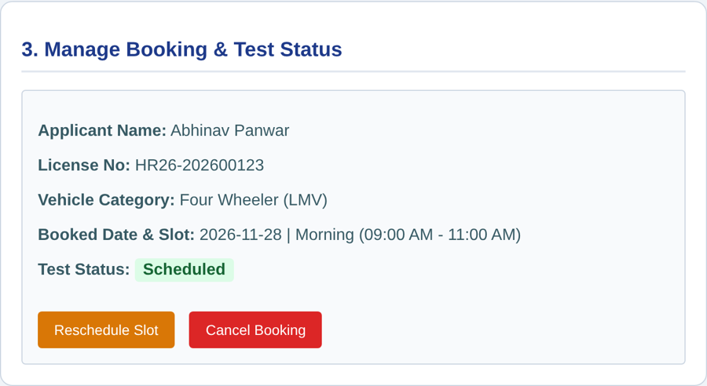
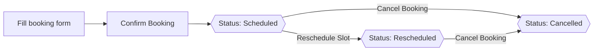

<div align="center">

# 🚗 RTO Driving Test Slot Management System

**Book, reschedule and cancel RTO driving test slots from a single web page.**

[](https://rto-driving-slots.vercel.app/)


[](LICENSE)

### 🔗 [Try it live → rto-driving-slots.vercel.app](https://rto-driving-slots.vercel.app/)


*Team project for **CSE 326: Web Development**, Lovely Professional University*

</div>

---

## 📑 Contents

- [Overview](#-overview)
- [Features](#-features)
- [Screenshots](#-screenshots)
- [How it works](#%EF%B8%8F-how-it-works)
- [Tech stack](#%EF%B8%8F-tech-stack)
- [Project structure](#-project-structure)
- [Getting started](#-getting-started)
- [Concepts applied](#-concepts-applied)
- [Roadmap](#%EF%B8%8F-roadmap)
- [Team](#-team)
- [License](#-license)

---

## 📌 Overview

Driving test centres handle many applicants but only a few test slots each day. When booking is done by hand, slots clash, some time slots fill up while others go unused, and changing a booking usually means another trip to the centre.

This app puts the whole process on one page: an applicant registers, picks a vehicle category, date and time slot, and can then reschedule or cancel the booking and see its current status.

## ✨ Features

| Feature | Description |
|---|---|
| 📝 **Applicant registration** | Full name and learner licence number, with required-field validation |
| 🏍️ **Vehicle category** | Two Wheeler (MCWG), Four Wheeler (LMV), or both |
| 📊 **Available slots** | Table of today's time slots with seats left and Open / Full status |
| 📅 **Booking** | Choose a test date and a morning, afternoon or evening slot |
| 🔁 **Rescheduling** | Move an existing booking to a new date |
| ❌ **Cancellation** | Cancel the booking in one click |
| 🏷️ **Test status** | Live badge showing **Scheduled**, **Rescheduled** or **Cancelled** |

## 📸 Screenshots

| Available slots | After booking |
|:---:|:---:|
|  |  |

## ⚙️ How it works



1. The applicant fills in the booking form and clicks **Confirm Booking**.
2. `bookSlot()` in [`script.js`](script.js) stops the page from reloading (`event.preventDefault()`), reads each field with `getElementById(...).value`, and copies the values into the booking card with `innerText`.
3. The booking card is shown (`style.display = "block"`) with the status **Scheduled**.
4. **Reschedule Slot** asks for a new date with `prompt()` and sets the status to **Rescheduled**. **Cancel Booking** sets it to **Cancelled**.

## 🛠️ Tech stack

| Language | Used for | File |
|---|---|---|
| **HTML5** | Page structure: header, navigation, form, table, status card | [`index.html`](index.html) |
| **CSS3** | Layout, colours, cards, buttons and table styling | [`style.css`](style.css) |
| **JavaScript** | Booking, rescheduling and cancelling without a page reload | [`script.js`](script.js) |

No frameworks, libraries or build tools — just plain HTML, CSS and JavaScript. Hosted on **Vercel** as a static site.

## 📁 Project structure

```
DRIVING-SLOT-MANAGEMENT-SYSTEM/
├── index.html          # Page markup: form, slots table, status card
├── style.css           # All styling
├── script.js           # bookSlot(), rescheduleSlot(), cancelSlot()
└── screenshots/        # Images used in this README
```

## 🚀 Getting started

**Use it online:** open **[rto-driving-slots.vercel.app](https://rto-driving-slots.vercel.app/)**.

**Run it locally:**

```bash
git clone https://github.com/legend0x01/DRIVING-SLOT-MANAGEMENT-SYSTEM.git
cd DRIVING-SLOT-MANAGEMENT-SYSTEM
```

Then open `index.html` in any modern browser. Nothing needs to be installed.

## 📚 Concepts applied

<details>
<summary><b>HTML</b></summary>

Forms, `input` (text, date), `select` / `option`, `required` validation, tables (`tr`, `th`, `td`), anchor links for in-page navigation, `id` / `class` attributes, external CSS and JS files.
</details>

<details>
<summary><b>CSS</b></summary>

Id, class and element selectors, the box model (margin, padding, border), `border-radius`, the `:hover` pseudo-class, `border-collapse`, centring with `margin: auto`.
</details>

<details>
<summary><b>JavaScript</b></summary>

Functions, DOM access with `getElementById`, `innerText` and `.value`, `onsubmit` / `onclick` events, `preventDefault()`, showing and hiding elements with `style.display`, `alert()` and `prompt()`, `if` conditions.
</details>

## 🗺️ Roadmap

- [ ] Save bookings in `localStorage` or a database so they survive a page refresh
- [ ] Decrease "seats left" automatically when a slot is booked
- [ ] Block past dates and full slots
- [ ] Add a login for test officers to record Pass / Fail

## 👥 Team

| Name | Roll No. |
|---|:---:|
| Mukul Sharma | 74 |
| Abhinav Panwar | 37 |
| Vansh Chaudhary | 73 |

**Faculty:** Dr. Puneet Thapar &nbsp;·&nbsp; **Section:** KRP26WK &nbsp;·&nbsp; **Course:** CSE 326, Web Development

## 📄 License

Released under the [MIT License](LICENSE).

---

<div align="center">

⭐ If you found this project useful, consider giving it a star!

**[🔗 Live Demo](https://rto-driving-slots.vercel.app/)**

</div>
