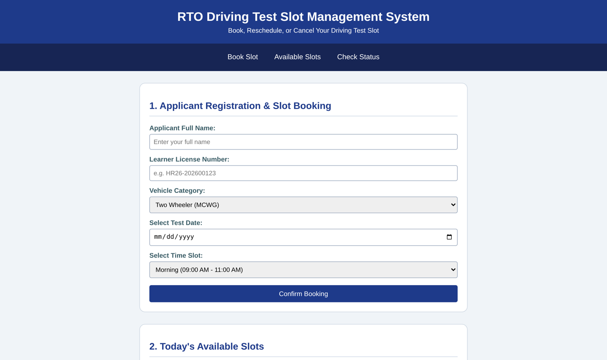
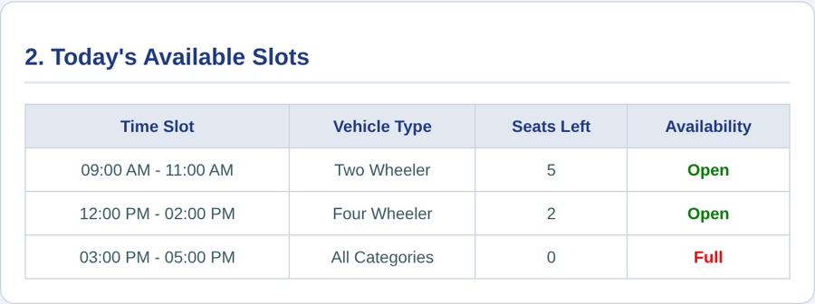

# Driving Test Slot Management System

A simple web app for booking, rescheduling and cancelling RTO driving test slots. It was built as our team project for **CSE 326: Web Development** at Lovely Professional University.

## The problem

Driving test centres have many applicants and only a few test slots each day. When booking is done by hand, slots clash, some time slots fill up while others go unused, and changing a booking usually means another trip to the centre.

## What the app does

Everything happens on one page:

- **Applicant registration:** full name and learner licence number
- **Vehicle category:** Two Wheeler (MCWG), Four Wheeler (LMV), or both
- **Available slots:** a table of today's time slots, showing seats left and whether each slot is open or full
- **Booking:** pick a test date and a morning, afternoon or evening slot
- **Rescheduling:** move the booking to a new date
- **Cancellation:** cancel the booking
- **Test status:** a badge showing Scheduled, Rescheduled or Cancelled

| Available slots | After booking |
|---|---|
|  |  |

## How it works

1. The applicant fills in the booking form and clicks **Confirm Booking**.
2. `bookSlot()` in `script.js` stops the form from reloading the page (`event.preventDefault()`), reads each field with `getElementById(...).value`, and copies the values into the booking card with `innerText`.
3. The booking card appears (`style.display = "block"`) with the status **Scheduled**.
4. **Reschedule Slot** asks for a new date with `prompt()` and changes the status to **Rescheduled**. **Cancel Booking** changes the status to **Cancelled**.

## Tech stack

| Language | Used for | File |
|---|---|---|
| HTML | Page structure: header, navigation, form, table, status card | `index.html` |
| CSS | Layout, colours, cards, buttons and table styling | `style.css` |
| JavaScript | Booking, rescheduling and cancelling without reloading the page | `script.js` |

No frameworks or libraries are used, only plain HTML, CSS and JavaScript.

## Concepts applied

- **HTML:** forms, `input` (text, date), `select`/`option`, `required` validation, tables (`tr`, `th`, `td`), anchor links for in-page navigation, `id`/`class` attributes, external CSS and JS files
- **CSS:** id, class and element selectors, the box model (margin, padding, border), `border-radius`, the `:hover` pseudo-class, `border-collapse`, centring with `margin: auto`
- **JavaScript:** functions, DOM access with `getElementById`, `innerText` and `.value`, `onsubmit`/`onclick` events, `preventDefault()`, showing and hiding elements with `style.display`, `alert()` and `prompt()`, `if` conditions

## Run it

1. Clone or download this repository.
2. Open `index.html` in any web browser.

Nothing needs to be installed.

## Future scope

- Save bookings in `localStorage` or a database so they survive a page refresh
- Reduce "seats left" automatically when a slot is booked
- Block past dates and full slots
- Add a login for test officers to record Pass or Fail

## Team

| Name | Roll No. |
|---|---|
| Mukul Sharma | 74 |
| Abhinav Panwar | 37 |
| Vansh Chaudhary | 73 |

**Faculty:** Dr. Puneet Thapar  
**Section:** KRP26WK  
**Course:** CSE 326, Web Development

## License

Released under the [MIT License](LICENSE).
